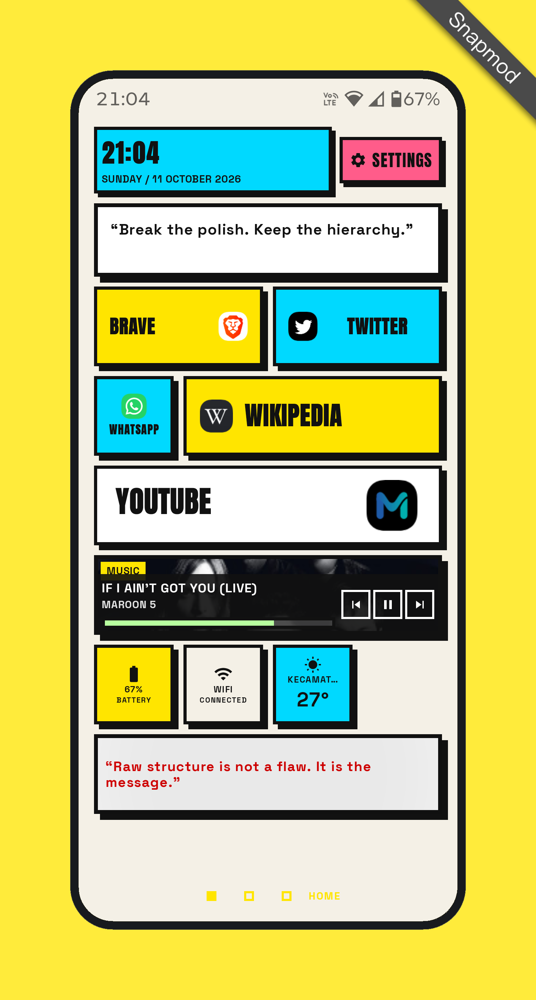
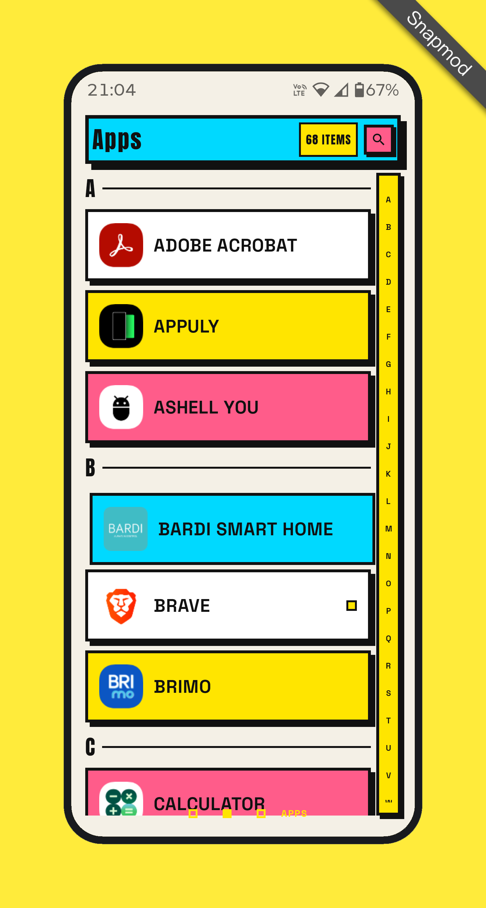
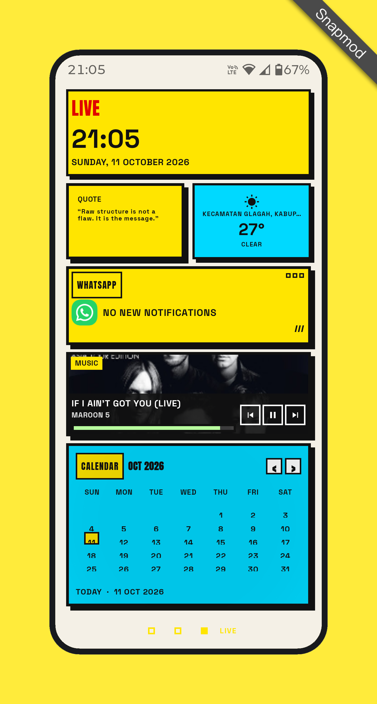
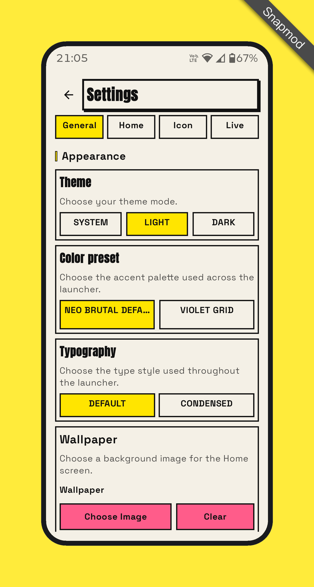
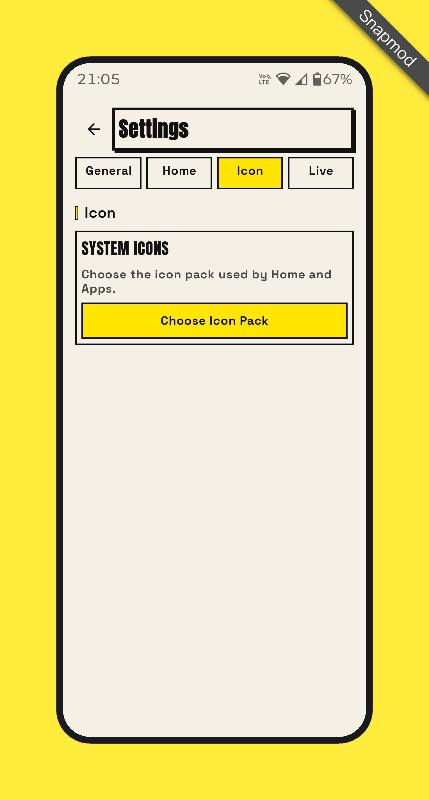
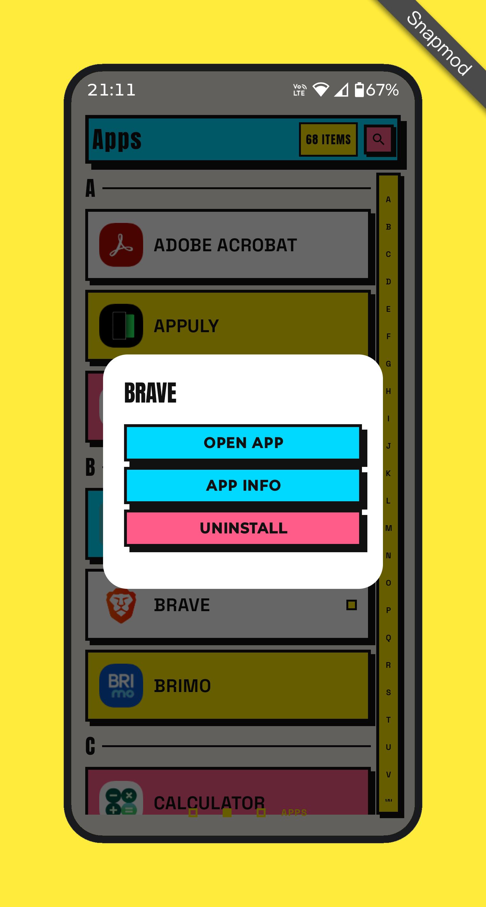

# NB Launcher — Embrace Your Screen.

**Neo-Brutalism for your Android homescreen. Because minimalism had its moment. lol.**

Ever wondered what happens when someone who can't code tries to build an Android app with AI?

Well, you're looking at it.

## 🤔 The Origin Story

For a while, I've been curious about AI tools that can build Android apps. The problem? Subscriptions cost money, and my wallet wasn't exactly ready for that kind of commitment.

But I had an idea: **What if I made an Android launcher inspired by Neo-Brutalism?**

Why Neo-Brutalism? Because, honestly, I'm getting tired of seeing the same minimalist homescreens everywhere.

Black. White. Muted colors. Tiny icons. Everything clean, everything subtle, everything trying so hard not to exist.

Meanwhile, our smartphones have AMOLED displays, high-resolution screens, refresh rates up to 120Hz, and millions of colors. Technology people ten years ago could barely imagine.

And what do we do with all that?

Make everything black and white. 💀

No hate to minimalism. If that's your thing, you do you. Personally, though, I want my homescreen to have a little more personality.

**Less minimal. More brutal.**

## 🤖 Me + AI = This Launcher?

Here's the plot twist: I don't know how to code, I don't own a laptop, and I had no prior experience building apps with AI.

I just had an idea and decided to give it a shot.

I bring the ideas, guide the direction, test builds, report bugs, and keep pushing for changes. AI helps turn those ideas into something real. So no, it wouldn't be honest to claim this launcher was made by me alone. AI played a huge role in building it.

Think of this project as an experiment in what happens when curiosity, an unconventional idea, and AI work together.

And honestly? I'm not even sure how many people will use it. But hey, you've got to start somewhere, right? lol.

## 📱 Your Screen Deserves Better

Let's be real: no matter how minimalist your launcher is, you're probably still glued to your smartphone anyway. 😂

So why not make the screen you look at every day a little more interesting?

NB Launcher is for Android users who want to make better use of their screen and break away from the usual minimalist aesthetic.

Think bold layouts, chunky borders, strong contrasts, and that unapologetically loud Neo-Brutalist vibe.

This isn't about making your phone less distracting by making everything disappear. It's about giving your homescreen a distinct personality.

**Embrace your screen. Brave yourself.**

Welcome to the anti-minimalist side of Android.

## 👀 Take a Look

| Home | Apps |
|---|---|
|  |  |

| Live | Settings |
|---|---|
|  |  |

| More settings | More settings |
|---|---|
|  |  |

## 🧱 What Can It Do?

- **Home screen:** clock, date, quotes, app tiles, battery and network information, optional weather, and music controls.
- **Customizable tiles:** arrange app tiles on the Home screen and adjust their sizes.
- **Apps page:** search installed apps, browse alphabetically, and launch apps quickly.
- **Live page:** useful live information, notification summaries, media controls, quotes, and optional weather.
- **Personalization:** light, dark, or system theme, plus wallpaper and typography options.
- **Quick gestures:** double-tap the Home clock to open Settings and long-press it to open Apps.

More features and improvements may come as development continues. This project is still evolving, and there's plenty left to experiment with.

## 🛠️ Open Source. Build It Yourself.

NB Launcher is open source, so you're free to explore the code and build it yourself.

- **Source code:** [Browse the repository](https://github.com/insomdroid/NeoBrutalauncher)
- **Download:** [Get the latest build from GitHub Actions](https://github.com/insomdroid/NeoBrutalauncher/actions)
- **Latest release:** [Download the APK](https://github.com/insomdroid/NeoBrutalauncher/releases)

You don't have to take my word for anything. Check out the source, see how the project evolves, and decide for yourself whether it's worth a place on your homescreen.

Suggestions, bug reports, and constructive criticism are welcome.

## 🐈 The Future: Feed the Cat?

Oh, and I'm not done yet.

There may be more features in the future, including some that could be available exclusively to people who have generously contributed to feeding my cat. 😼

Yes, you read that right. The cat may become part of the monetization strategy.

No promises, though. The cat hasn't reviewed the roadmap yet.

## 💌 Get in Touch

Got ideas, found a bug, or just want to tell me what you think?

- **Email:** [insomdroid3@gmail.com](mailto:insomdroid3@gmail.com)
- **Ko-fi:** [ko-fi.com/insomdroid](https://ko-fi.com/insomdroid)

If you enjoy the project and want to support its development, you can also buy the cat a meal. Every bit of support helps keep the experiment going.

---

**TL;DR:** I wanted a Neo-Brutalist Android launcher, couldn't code, couldn't afford an AI subscription, and decided to try anyway. AI helped me build it, and now you can try it too.

Minimalism isn't dead. I'm just giving your homescreen another option.

**NB Launcher — Embrace Your Screen.** 🧱
